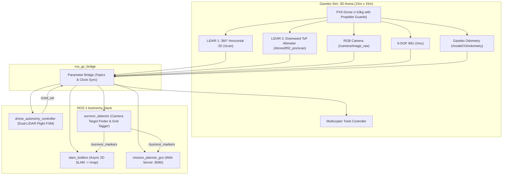

# NIDAR AirMouse - Dual-LiDAR GPS-Denied Indoor Search & Mapping Drone

ROS 2 (Jazzy) & Gazebo Sim workspace for the **NIDAR AirMouse Autonomous Indoor Search, 2D SLAM Mapping & Survivor Localisation Challenge**.

---

## Mission Brief Compliance Matrix

| Mission Requirement (from PDF) | Solution Implementation | Status |
| :--- | :--- | :--- |
| **GPS-Denied Operation** | Pure LiDAR-only navigation, IMU orientation & relative odometry; no GPS/GNSS. | **Compliant** |
| **Dual-LiDAR Sensor Configuration** | **LiDAR 1 (Horizontal 360° 2D)**: Real-time 2D SLAM, corridor centering, wall safety.<br>**LiDAR 2 (Downward ToF)**: Sub-cm altitude hold, ceiling net protection, auto-landing. | **Compliant** |
| **Covered Arena & Net Protection** | Cruising altitude regulated at 1.20m; emergency vertical limiter at 1.70m prevents touching the 2.44m (8ft) ceiling net. | **Compliant** |
| **Real-time 2D SLAM Mapping** | `slam_toolbox` asynchronously processes 360° LaserScan to generate and continuously display 5cm resolution `/map`. | **Compliant** |
| **Survivor Detection & Localisation** | Camera detects dummy survivors, computes estimated world coordinates, identifies grid boxes (e.g. `Grid [2, 2]`), and tags `/survivor_markers` on the 2D map. | **Compliant** |
| **GCS / Mission Planner (Section 5)** | Real-time web-based Mission Planner dashboard at `http://localhost:8080` displaying live camera feed, 2D map canvas with survivor pins, telemetry HUD, and command controls. | **Compliant** |
| **Propeller Guard Constraint** | Full 360° protective propeller guards on all 4 rotor operating areas (weight < 10 kg). | **Compliant** |
| **Designated Entry & Exit Pad** | Autonomous takeoff from `(-5.8, -6.0)`, maze exploration, and Return-to-Home (`RTH`) landing. | **Compliant** |

---

## System Architecture



---

## Dual-LiDAR Roles

1. **LiDAR 1: Horizontal 360° 2D LiDAR (`/scan`)**
   - **Mounted**: Top-center frame (`pose="0 0 0.08 0 0 0"`, frame: `laser_frame`).
   - **Range**: 0.15m to 15.0m, 360 samples at 10 Hz.
   - **Role**: Feeds `slam_toolbox` for 2D floorplan SLAM mapping, computes reactive corridor centering in >= 1.0m passages, handles wall deceleration, corner turns, and dead-end turnaround.

2. **LiDAR 2: Downward ToF LiDAR (`/drone/tf02_pro/scan`)**
   - **Mounted**: Bottom-center facing downwards (`pose="0 0 -0.05 0 1.5708 0"`, frame: `tf02_link`).
   - **Range**: 0.10m to 40.0m at 100 Hz.
   - **Role**: Sub-centimeter closed-loop altitude hold, ceiling net protection (stops drone below 1.70m under 2.44m net), autonomous climb-to-cruising takeoff, and gentle precision landing on launch pad.

---

## Directory Structure

```
├── README.md
├── run_autonomous.sh               # One-click autonomous mission launcher
├── run_arena.sh                    # Manual arena simulator launcher
├── test_autonomous.sh              # CLI utility for autonomous flight commands
├── test_drone.sh                   # Manual velocity testing utility
└── src
    └── nidar_gazebo
        ├── CMakeLists.txt
        ├── package.xml
        ├── config
        │   ├── ros_gz_bridge.yaml       # Bridge topics (Sensors, Cmd_vel, Clock)
        │   ├── slam_toolbox_params.yaml # Async 2D SLAM parameters
        │   └── nidar_gcs.rviz           # RViz2 display layout
        ├── launch
        │   ├── autonomous_drone.launch.py # Complete mission launch
        │   └── nidar_sim.launch.py        # Bridge-only launch
        ├── models
        │   ├── px5_drone                # Multicopter with guards & dual LiDARs
        │   └── airmouse_drone           # Lightweight airframe model
        ├── scripts
        │   ├── drone_autonomy_controller.py # Dual-LiDAR flight controller & TF
        │   ├── survivor_detector.py         # Survivor finder & map marker tagger
        │   └── mission_planner_gcs.py       # Ground Control Station Web UI
        └── worlds
            └── nidar_arena.sdf          # 15m x 15m covered maze with rooms & survivors
```

---

## Quick Start: Running the Autonomous Mission

### 1. Build the Workspace

```bash
cd /home/shubham/avni_ws
colcon build --symlink-install
source install/setup.bash
```

### 2. Launch Autonomous Simulation

Launch the complete stack (Gazebo arena, dual LiDARs, SLAM, autonomy controller, survivor detector, and web GCS):

```bash
./run_autonomous.sh
```

**Options:**
- Run headless (server-only):
  ```bash
  ./run_autonomous.sh --headless
  ```
- Auto-takeoff immediately on start:
  ```bash
  ./run_autonomous.sh --auto-start
  ```
- Launch with RViz2 visualization:
  ```bash
  ./run_autonomous.sh --rviz
  ```

---

## Ground Control Station (GCS) Web Dashboard

Once launched, open your web browser on your Mac or local machine:

👉 **`http://localhost:8080`** (or if connected via SSH, **`http://10.7.17.204:8080`**)

> [!TIP]
> **Accessing from your Mac over SSH:**
> - **Option A (Direct)**: If your Mac and Linux machine are on the same local network or Tailscale, open `http://10.7.17.204:8080` (or `http://100.74.108.6:8080`) directly in Safari/Chrome on your Mac.
> - **Option B (SSH Port Forwarding)**: On your Mac terminal, connect with:
>   ```bash
>   ssh -L 8080:localhost:8080 shubham@10.7.17.204
>   ```
>   Then simply open **`http://localhost:8080`** in your Mac browser.
> - **Option C (Terminal ASCII Monitor)**: In an SSH terminal session on the Linux host, run:
>   ```bash
>   python3 monitor_terminal.py
>   ```
>   This displays a real-time ASCII arena map, live drone grid coordinates, dual-LiDAR clearances, and survivor detections directly in your terminal.

### Features on GCS Dashboard:
- **Live 2D SLAM Map Canvas**: Displays expanding map from LiDAR 1 with drone location, heading, flight trajectory trail, and tagged survivor pins.
- **Live Camera Stream**: Displays 30 FPS camera feed with survivor detection bounding boxes and sector labels.
- **Dual-LiDAR Telemetry**: Live altitude from Downward ToF LiDAR, front/side wall clearances, and grid coordinates.
- **Survivor Log Table**: Tagged survivor IDs, Room names, Grid coordinates, and status.
- **Mission Control Buttons**: One-click triggers for `Takeoff`, `Explore`, `Hover`, `Return To Home (RTH)`, `Land`, and `Emergency Stop`.

---

## Autonomous CLI Commands

While the simulation is running, open a new terminal:

```bash
# Command autonomous takeoff to 1.20m altitude
./test_autonomous.sh takeoff

# Command autonomous maze exploration & corridor following
./test_autonomous.sh explore

# Command autonomous Return-To-Home to designated entry/exit pad
./test_autonomous.sh rth

# Command precision auto-landing using Downward ToF LiDAR
./test_autonomous.sh land

# Echo live drone telemetry and state
./test_autonomous.sh status

# Echo detected survivor coordinates and grid tags
./test_autonomous.sh survivors
```
